# 宠物医院预约问诊系统

[](https://github.com/chake111/pet-clinic/actions/workflows/ci.yml)

单家宠物医院自用的预约 + 在线图文问诊系统。宠物主人在手机上找医生、挂号、付款、发起免费图文问诊、拿病历和评价；医生在后台接诊、写病历，还能在会话里一键建议患者到院挂号；管理员管科室、医生、排班、公告和全院数据。

前后端分离：Vue 3 单工程承载用户端与后台，Spring Boot 3 提供 REST + WebSocket 接口，MySQL 存全部业务数据。

## 功能范围

**用户端**（未登录可浏览医生，下单前才要求登录）

- 账号注册 / 登录，资料与密码维护
- 宠物档案：多只宠物，种类、品种、体重、绝育与过敏史
- 找医生：按科室、关键词筛选，按综合 / 评分 / 接诊量排序
- 医生详情：擅长领域、简介、未来 7~30 天号源、患者评价（含医生回复）
- 挂号下单：选宠物、选时段、填病情描述、最多 6 张症状图
- 模拟支付：点一下即支付；30 分钟未支付由定时任务取消并退回号源
- 图文问诊：从医生主页直接发起，选宠物 + 描述症状即建会话——免费、不限次、不占号源、不走支付
- 问诊会话：WebSocket 实时消息，文字 + 图片，已送达 / 已读回执，医生在线状态；患部照片点开看大图，可左右翻阅整场会话的历史图
- 到院建议：医生在会话里一键发「建议到院」卡片，患者点卡片直达该医生的挂号页
- 问诊小结：医生结束问诊时留一段书面结论（线上只建议、确诊要面诊），展示在患者会话顶部
- 电子病历：主诉、体格检查、诊断、处方、处置、医嘱、复诊日期、检查影像
- 就诊评价：三维评分 + 文字 + 图片，可匿名；医生回复公开展示
- 我的预约 / 病历 / 会话列表，未读消息角标

**后台**（管理员与医生共用一套界面，按角色裁剪菜单）

- 医生：我的会话（接诊、建议到院、写问诊小结）、接诊工作台（接诊 + 写病历 + 结束就诊同屏）、我接诊的工单与病历、我的排班、评价回复
- 管理员：看板统计、全部工单、用户账号与宠物档案、排班号源（单条与按周批量）、医生管理、科室管理、公告科普、病历查询、评价显隐治理、问诊记录只读追溯

**两端共用**

- 图片查看器：聊天患部照片、病情描述附图、检查影像、评价附图、公告封面都能点开大图，支持滚轮缩放与旋转；同一组图整体进查看器，左右键翻阅，顶部标注这张图的来源（谁在什么时间发的），图取不到时给明确说明而不是裂图

## 界面预览

配图来自运行中的前后端，展示演示账号的实际页面。

**用户端**（窄屏 430 宽）

| 找医生 | 选号下单 | 图文问诊 | 我的病历 |
| --- | --- | --- | --- |
| 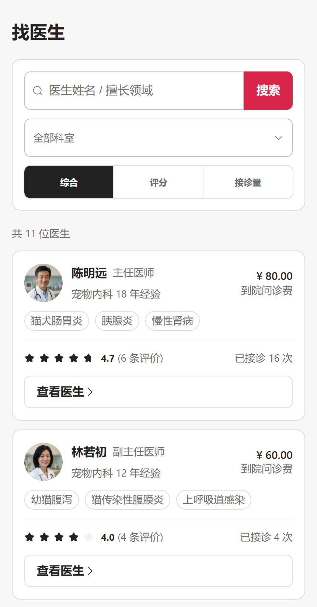 | 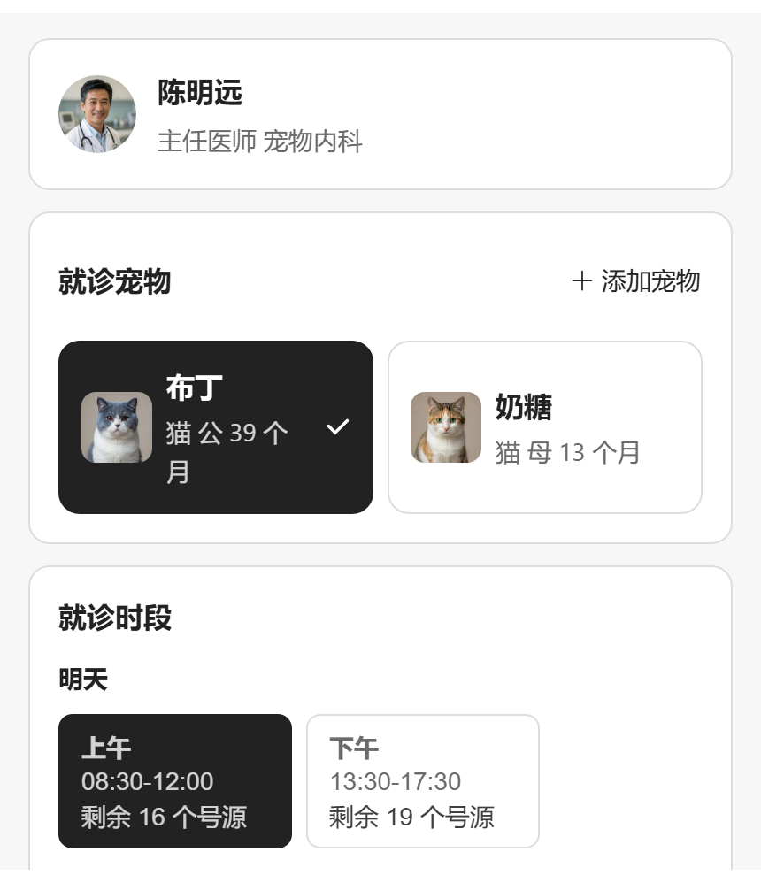 | 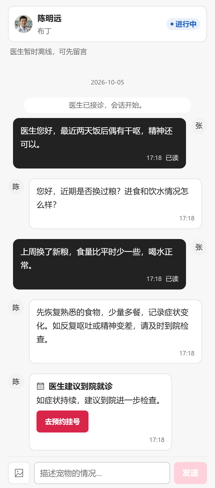 | 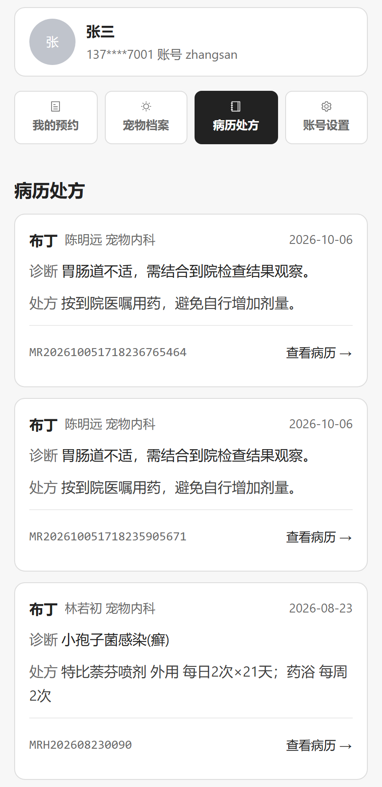 |

**管理后台**（1440 宽）

| 工作台看板 | 排班号源 | 医生管理 | 接诊工作台 |
| --- | --- | --- | --- |
| 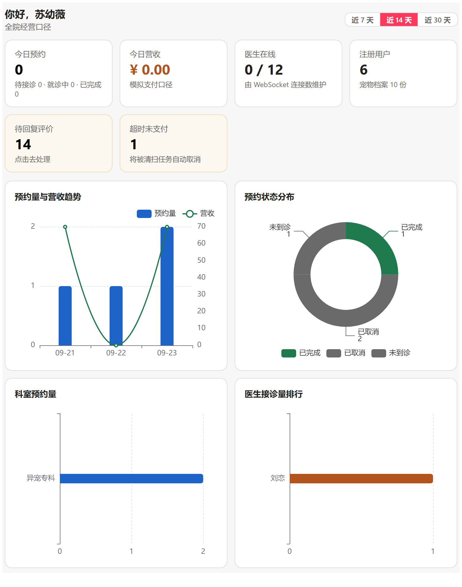 | 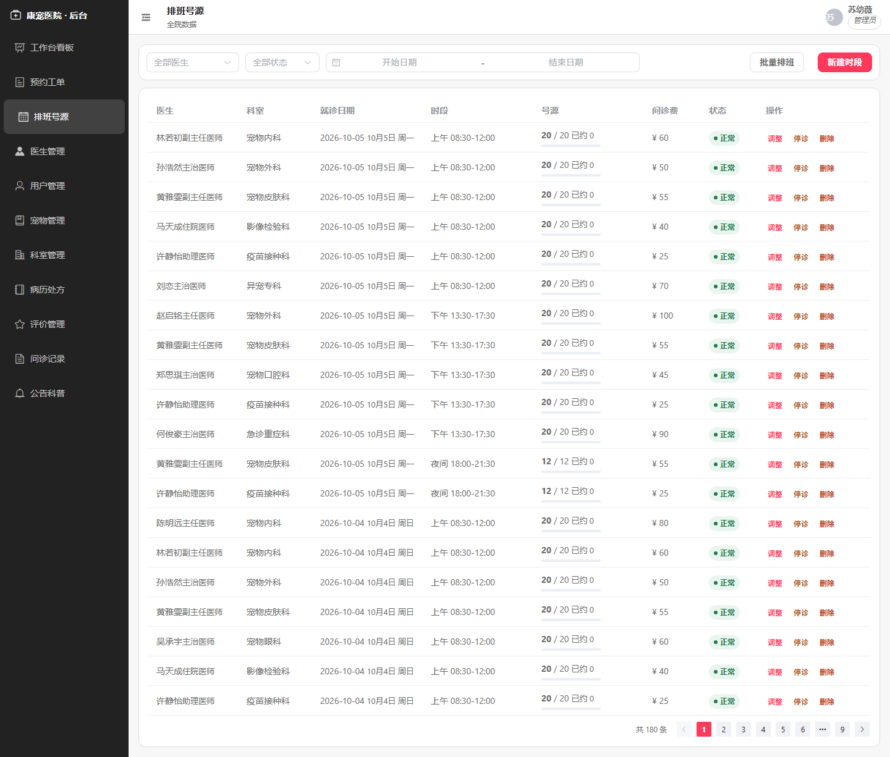 | 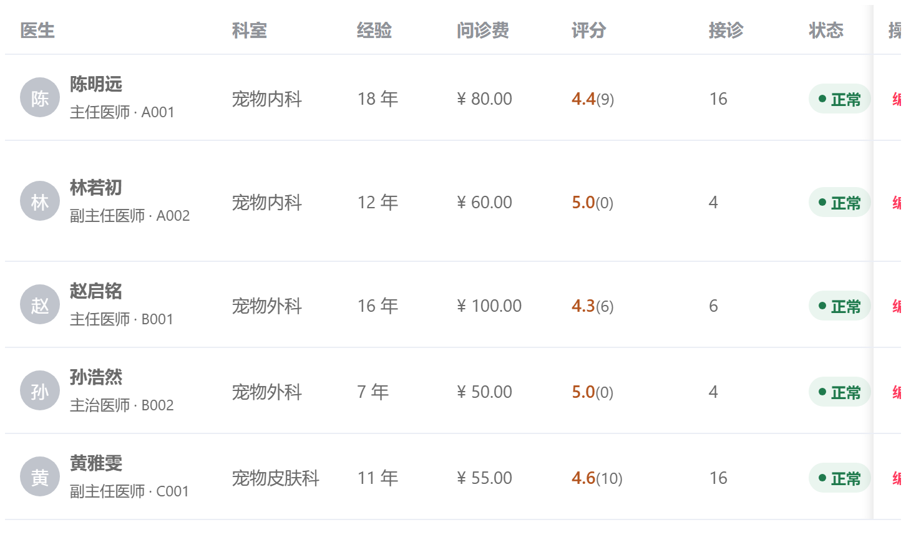 | 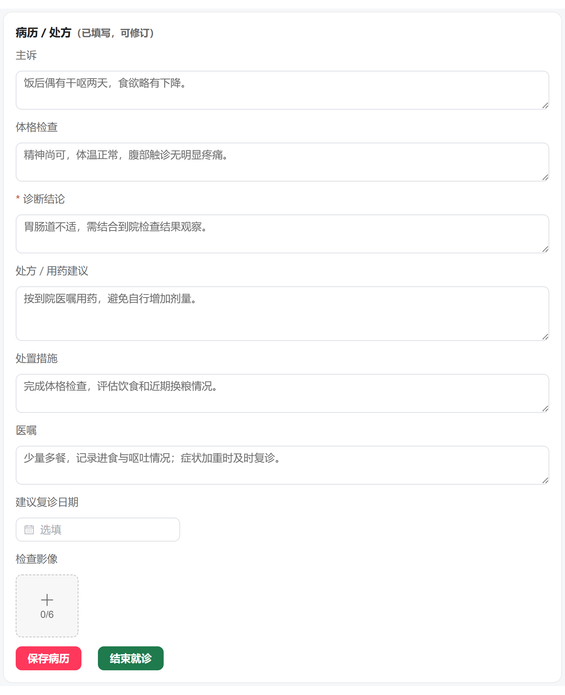 |

**基础数据维护**（1440 宽，第二批补齐的后台页面）

| 用户管理 | 宠物管理 | 问诊记录 |
| --- | --- | --- |
| 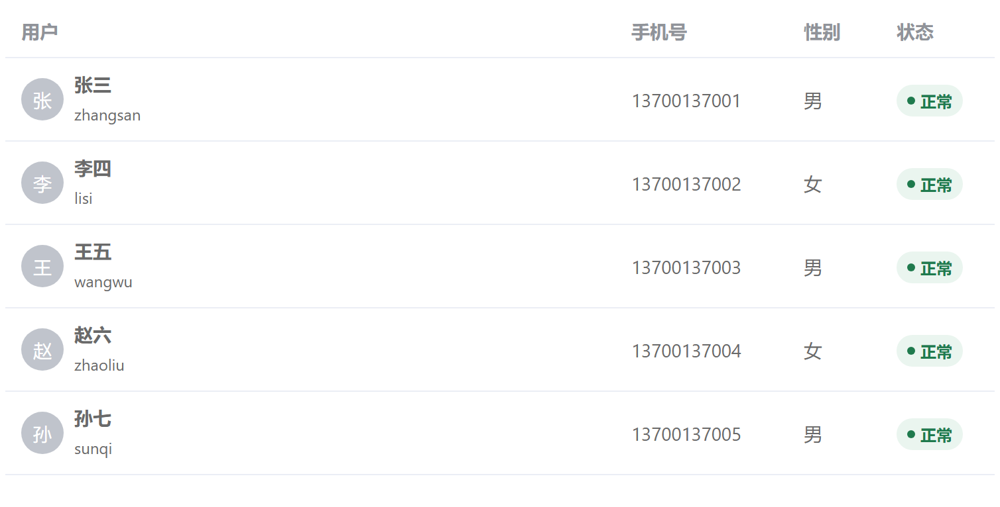 | 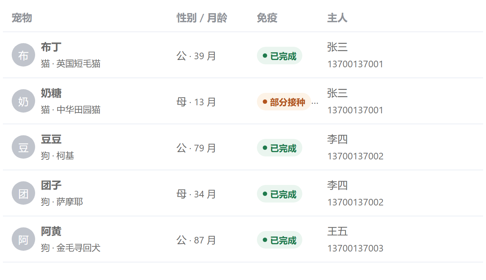 | 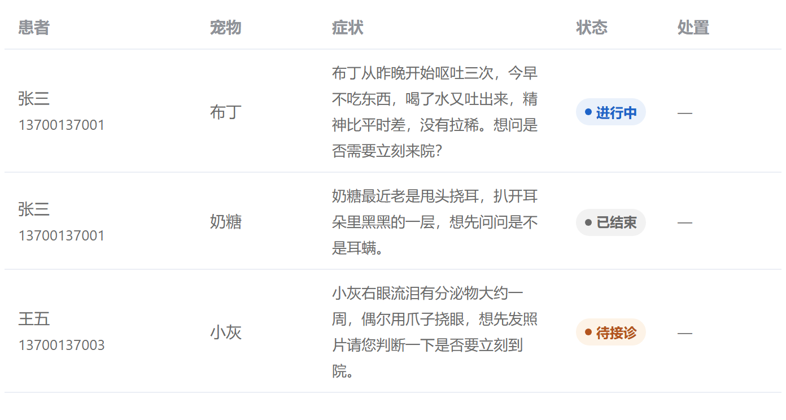 |

完整截图在 `docs/screenshots/`，按用户端、后台与医生端编号命名：用户端的登录注册、首页、医生详情、发起图文问诊、宠物档案、我的预约、线上支付、就诊评价、问诊会话与聊天页；后台的登录、工单、排班、医生、用户、宠物、病历、评价、问诊记录、公告；以及医生视角的会话列表、聊天页、我的排班与结束问诊（小结）。

## 技术栈

| 层 | 选型 |
| --- | --- |
| 前端 | Vue 3.5 Vite 5.4 Element Plus 2.8+ Pinia 2 Vue Router 4 Axios 1.7 ECharts 5.5 |
| 后端 | Spring Boot 3.5.16 JDK 17 MyBatis-Plus 3.5.17 原生 WebSocket jjwt 0.12.6 |
| 接口文档 | springdoc-openapi 2.8 + Swagger UI（OpenAPI 3） |
| 数据 | MySQL 8（库名 `pet_clinic`，12 张表，逻辑外键，逻辑删除） |
| 认证 | JWT（HMAC-SHA，jjwt 按密钥长度自动选 HS256/384/512；7 天）+ `HandlerInterceptor` 路径前缀鉴权 + `@RequireRole`；密码 BCrypt |

号源防超卖靠一条带条件的 UPDATE 实现。

## 持续集成

每次 push 到 `main` 或向 `main` 提交 PR，GitHub Actions 会执行：

- 后端：JDK 17 + `mvn --batch-mode --no-transfer-progress verify`（单元测试 + 打包）
- 前端：Node.js 22 + `npm ci`、`npm run lint`、`npm test`、`npm run build`

工作流见 [`.github/workflows/ci.yml`](.github/workflows/ci.yml)，action 版本由 Dependabot 每周检查。

## 测试与质量

CI 覆盖后端单元测试与前端 lint / test / build；隔离环境下的接口与浏览器验收脚本见 [tools/README.md](tools/README.md)，过程证据在 [docs/test-evidence/](docs/test-evidence/)。

## 快速开始

```bash
# 1. 建库导数据。01_schema.sql 自带 DROP/CREATE DATABASE，不要预先手建
mysql -uroot -p < sql/01_schema.sql
mysql -uroot -p pet_clinic < sql/02_data.sql

# 2. 后端（8081，上下文 /api）。JWT 密钥没有默认值，未设置会启动失败
export JWT_SECRET='dev-only-please-use-a-random-32-byte-secret'
cd backend && mvn spring-boot:run

# 3. 前端（5173，代理 /api 到 8081）
cd frontend && npm install && npm run dev
```

打开 http://127.0.0.1:5173 即可。完整的前置条件、端口冲突处理、生产构建与目录约定见 [docs/部署步骤.md](docs/部署步骤.md)。

## 演示账号

种子数据里的密码统一是 `123456`，登录页有点击填充的快捷按钮。

| 入口 | 账号 | 身份 | 说明 |
| --- | --- | --- | --- |
| `/` | `zhangsan` | 患者 | 有预约、病历和进行中的问诊会话 |
| `/` | `lisi` | 患者 | 新用户，适合演示注册到下单全流程 |
| `/admin/login` | `admin` | 管理员 | 全院菜单与数据 |
| `/admin/login` | `doctor01` | 医生（陈明远） | 有当日排班 |
| `/admin/login` | `doctor11` | 医生（刘恋） | 有进行中 / 待接诊 / 已结束的图文会话，和一张待接诊的到院单 |

`service01` 是第二个管理员（前台客服），`zhouba` 是禁用账号示例，用于演示账号状态校验。

## 目录结构

```
├── sql/            01_schema.sql 建表 + 02_data.sql 种子数据（脱敏但贴近真实）+ migrations/ 增量迁移
├── backend/        Spring Boot 服务
│   └── src/main/java/com/petclinic/
│       ├── common/     Result / PageResult / BizException / 全局异常处理
│       ├── config/     MVC、拦截器、MyBatis-Plus、Jackson、OpenAPI、WebSocket、配置属性
│       ├── security/   JWT 工具、AuthInterceptor、WsHandshakeInterceptor、AccountGuard
│       ├── controller/ client/（用户端） admin/（后台） common/（上传）
│       ├── service/    业务层（预约、排班、问诊、病历、评价、统计）
│       ├── entity/ mapper/ dto/ vo/
│       ├── websocket/  会话注册表与图文消息处理器
│       └── task/       超时未支付订单清扫
├── frontend/       Vue 3 单工程
│   └── src/
│       ├── api/      按端拆分的接口封装 + 唯一 axios 实例
│       ├── assets/   logo 与吉祥物图等静态资源
│       ├── layouts/  ClientLayout（窄栏 + 底部 tab）/ AdminLayout（侧边菜单）
│       ├── router/   路由表（用户端与后台两套入口）
│       ├── views/    client/（用户端页面） admin/（后台与医生端页面）
│       ├── components/ ConsultPanel、ImageGallery、ImageViewerHost、ImageUpload、DeptIcon、MedicalRecordSheet、PaymentTicket、LoadFailure、LoginScene、LoginForm、ChangePasswordForm、DoctorCard、PetForm、PetPicker、StatusChip
│       ├── stores/   登录态与账号信息
│       ├── styles/   全局样式与变量
│       └── utils/    枚举文案、时间金额格式化、token、WebSocket 客户端、图片查看器状态、列表滚动、病历与排班展示、科室图标素材
├── docs/           设计约定 / 接口文档 / 数据模型 / 部署步骤 / ADR / 架构图 / 界面截图 / 测试证据
├── tools/          隔离测试环境与验收脚本（qa_env / acceptance / business_rules_check / main_flow_* / read_receipt / schedule_status / dashboard_query / trace_id）
└── .github/        CI 工作流与 Dependabot
```

## 文档

- [文档索引](docs/README.md)：所有文档的入口
- [接口文档](docs/接口文档.md)：统一响应结构、鉴权约定、按端分组的接口清单、WebSocket 帧协议
- [数据模型说明](docs/数据模型.md)：表职责、逻辑外键、关键字段与索引设计，由 `tools/gen_data_model.py` 从 `sql/01_schema.sql` 生成
- [部署步骤](docs/部署步骤.md)：环境要求、建库、启动、生产构建、常见问题
- [架构决策记录](docs/adr/)：关键取舍的裁定与理由（问诊与预约解耦、"未到诊"终态、陈氏 ER 等）
- [设计约定](docs/design.md)：用户端布局、色彩与组件规则
- [技术亮点改造记录](docs/技术亮点改造记录-20261114.md)：四个缺陷的根因、动作与验证

## 已知边界

- 支付是模拟的：只把 `pay_status` 置为已支付，取消时标记退款，不调用任何支付渠道。
- 图片存在后端进程的 `uploads/` 本地目录并以静态资源暴露，不接对象存储；换机器部署需要自己迁移该目录。
- 医生账号由管理员在数据库/后台维护，没有自助入驻与资质审核流程。
- 会话消息只有文字、图片和到院建议卡片，没有视频、语音与文件。
- 站内消息中心、疫苗提醒、医生独立工作台未纳入本次范围。
- Swagger UI 与 OpenAPI 描述（`/api/swagger-ui.html`、`/api/v3/api-docs`）免登录公开，方便联调与演示；上公网前应在网关屏蔽或以 `springdoc.api-docs.enabled=false` 关闭。
- CORS 与 WebSocket 握手允许任意来源（`WebMvcConfig` / `WebSocketConfig`，为开发期 Vite 直连后端所需，鉴权仍强制 token）；登录无速率限制。这两条假设生产环境由 nginx 同源转发兜住，直接暴露公网前需在网关层收敛。
