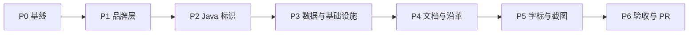

# 愈爪改名实施计划：品牌层、技术标识与历史证据

- 日期：2026-11-18
- 分支：`refactor/rename-yuzhua`
- 目标仓库：`chake111/yuzhua-pet-clinic`
- 状态：待执行
- 决策来源：2026-11-18 grilling 四轮澄清

> 一句话：用户看得见的品牌一次改到位；机器认的标识用脚本迁移并可验证；历史证据原样保留并加沿革说明。

---

## 1. 决策基线（已确认）

| 决策 | 结论 |
| --- | --- |
| 旧名范围 | 仓库实际旧名为「宠物医院预约问诊系统」，连同全部变体一起替换 |
| 正式全名 | `愈爪\|宠物医院预约与在线问诊平台`（正式文本逐字原样） |
| 浏览器 title | `愈爪 · 宠物医院预约与在线问诊平台` |
| 界面呈现 | 主字「愈爪」+ 副标题「宠物医院预约与在线问诊平台」 |
| 英文标识 | `yuzhua` |
| 技术标识 | 分层全改：包名、库名、配置前缀、环境变量、镜像、jar 全迁 |
| 数据库 | 写幂等重命名迁移脚本，不 DROP 旧库 |
| 品牌文案 | 收成单一事实源（前端 `brand.js` + 后端 `BrandProperties`） |
| 品牌资产 | 新字标：爪印 + 医疗十字圆标，珊瑚 `#FF385C`；中文粗体「愈爪」 |
| 截图 | 建 manifest 脚本重拍 `docs/screenshots/` 全部 32 张 |
| 历史证据 | `docs/test-evidence/**` 不重写，新增品牌沿革说明 |
| 明确不改 | JWT 历史密钥黑名单、功能词「图文问诊」、通用「宠物医院」描述、git 历史 |
| 交付 | 分支 + 多 commit + PR；GitHub 仓库改名 |

### 刻意保留的旧名残留

以下位置改完后仍会出现旧名，属于预期，不得在审计时误判为漏改：

1. `backend/src/main/java/com/yuzhua/security/JwtUtils.java` 两条历史泄漏密钥黑名单。
2. `docs/部署步骤.md` 中引用的同两条历史密钥示例（说明用途，保留原样）。
3. `docs/品牌沿革.md`（记录旧名→新名）。
4. `docs/test-evidence/**`（全部历史日志与图片）。
5. 本计划文档 `docs/愈爪改名计划-20261118.md`。
6. git 历史与已合并的旧 PR。

---

## 2. 三层模型

| 层 | 改什么 | 验收口径 |
| --- | --- | --- |
| 品牌展示层 | UI 文案、README 标题、OpenAPI title、package description、logo、截图 | 用户可见处无旧名；品牌文案只有一个事实源 |
| 技术标识层 | Java 包、类名、Maven 坐标、配置前缀、环境变量、库名、镜像、Grafana | 编译/测试/启动通过；grep 只剩白名单 |
| 历史证据层 | 不改 | 日志与图片逐字保持原样；沿革文档说明改名事实 |

---

## 3. 工作包与依赖



默认串行，不并行派发。原因：`application.yml`、README、`tools/qa_env.py` 被多个包先后触碰；截图需要前四个包完成后的可运行栈。

| 包 | 执行者 | 内容 | 预计 |
| --- | --- | --- | --- |
| P0 | 主代理 | 分支、基线、清单 | 0.5h |
| P1 | 子代理 A | 品牌单一事实源 + 前端展示 | 1.5h |
| P2 | 子代理 B | Java 包、启动类、Maven、运行配置 | 2h |
| P3 | 子代理 C | 数据库、compose、CI、Grafana、tools | 2.5h |
| P4 | 子代理 D | 文档、README、品牌沿革 | 1.5h |
| P5 | 子代理 E（oil-ui） | 字标、logo、截图脚本与 32 张重拍 | 3h |
| P6 | 主代理 + 审查子代理 | 全量验收、仓库改名、PR | 1.5h |

---

## 4. 工作包规格

每个工作包统一遵守：

- **先审查后执行**：先读本计划与相关文件，报告现状与计划差异；发现需要用户决策的冲突立即停止。
- **独占范围**：只改本包列出的文件/目录。
- **禁改**：其他包的范围、历史证据、JWT 黑名单、git 历史。
- **不 commit、不 push**：由主代理验收后统一提交。
- **回报格式**：状态、改动文件、验证命令与原始输出摘要、偏差、未决问题。

### P0 — 基线与分支（主代理）

**前置**：工作区干净，`main` 与 `origin/main` 同步。

**步骤**：

1. `git switch -c refactor/rename-yuzhua`
2. 记录基线：
   - `git rev-parse HEAD > /tmp/yuzhua-baseline.txt`
   - 后端：`cd backend && mvn -q -DskipTests package`
   - 前端：`cd frontend && npm run lint && npm test && npm run build`
   - 若 Docker 可用：`mvn -q verify`（Testcontainers 集成测试）；否则记录跳过原因。
   - `git grep -n -I -E '宠物医院预约问诊系统|pet[_-]?clinic|PetClinic' > /tmp/yuzhua-grep-baseline.txt`
3. 提交本计划：`docs: 添加愈爪改名实施计划`

**退出条件**：基线命令通过，或失败项被明确记录为「既有问题」。基线不绿不得进入 P1。

**回滚**：`git switch main`，删除分支。

---

### P1 — 品牌单一事实源 + 前端展示（子代理 A）

**前置**：P0 完成。

**独占范围**：

- `frontend/src/brand.js`（新建）
- `frontend/vite.config.js`
- `frontend/index.html`
- `frontend/src/components/LoginScene.vue`
- `frontend/src/layouts/ClientLayout.vue`
- `frontend/src/layouts/AdminLayout.vue`
- `frontend/package.json`
- `frontend/package-lock.json`（仅 name 字段）
- `frontend/tests/brand.test.mjs`（新建）

**禁改**：`frontend/src/assets/**`（P5）、`backend/**`（P2）、`README.md` 与 `docs/**`（P4）、`docs/screenshots/**`（P5）。

**审查要点**：

1. 用 `grep -rn "宠物医院预约问诊系统" frontend/src frontend/index.html frontend/package.json` 确认全部命中位置。
2. 确认 `AdminLayout.vue:100` 的「宠物医院院务工作台」不属于旧全名、但属于品牌展示，需改。
3. 确认 `index.html` 由 Vite 处理，`transformIndexHtml` 能拿到编译后的 HTML。

**步骤**：

1. 新建 `frontend/src/brand.js`：

   ```js
   export const BRAND = {
     name: '愈爪',
     fullName: '愈爪|宠物医院预约与在线问诊平台',
     title: '愈爪 · 宠物医院预约与在线问诊平台',
     tagline: '宠物医院预约与在线问诊平台',
     description: '愈爪 · 宠物医院预约与在线问诊平台：在线预约、图文问诊、病历管理'
   }
   ```

2. `index.html` 的 `<title>` 改为 `%BRAND_TITLE%`，`meta description` 改为 `%BRAND_DESCRIPTION%`。
3. `vite.config.js` 从 `brand.js` 导入常量，在 `transformIndexHtml` 中替换占位符。
4. `LoginScene.vue`：品牌链接主字改 `{{ BRAND.name }}`，并在链接内加副标题 `{{ BRAND.tagline }}`；`aria-label` 用 `BRAND.fullName + '首页'`。
5. `ClientLayout.vue`：顶栏主字改 `{{ BRAND.name }}`，加副标题；`aria-label` 用 `BRAND.fullName + '，返回首页'`。
6. `AdminLayout.vue`：`{{ BRAND.name }}` + `院务工作台`；logo `alt` 用 `BRAND.name`。
7. `frontend/package.json`：`name` 改 `yuzhua-frontend`，`description` 用 `BRAND.fullName + '前端（用户端 + 管理后台，单工程双入口）'` 的等价文案。
8. 新增 `frontend/tests/brand.test.mjs`：断言 `fullName`、`title`、`tagline` 精确值，且不包含旧名。

**验证 / 退出条件**：

- `cd frontend && npm run lint`
- `cd frontend && npm test`
- `cd frontend && npm run build`
- `grep -rn "宠物医院预约问诊系统" frontend/src frontend/index.html frontend/package.json` 结果为 0
- `dist/index.html` 的 `<title>` 为 `愈爪 · 宠物医院预约与在线问诊平台`
- 人工看 dev server 登录页与用户端顶栏：主字「愈爪」+ 副标题，不换行溢出

**回滚**：本包改动全部集中在 frontend，`git checkout -- frontend` 即可。

---

### P2 — Java 包与运行标识（子代理 B）

**前置**：P1 完成。

**独占范围**：

- `backend/src/main/java/com/petclinic/**` → `backend/src/main/java/com/yuzhua/**`
- `backend/src/test/java/com/petclinic/**` → `backend/src/test/java/com/yuzhua/**`
- `backend/src/main/java/com/yuzhua/config/BrandProperties.java`（新建）
- `backend/src/main/java/com/yuzhua/config/OpenApiConfig.java`
- `backend/src/main/java/com/yuzhua/PetClinicApplication.java` → `YuzhuaApplication.java`
- `backend/pom.xml`
- `backend/Dockerfile`
- `backend/src/main/resources/application.yml` 的 `spring.application.name`、`logging.level.*`、新增 `yuzhua.brand.*`
- `backend/src/main/resources/application-example.yml` 的同名项

**禁改**：`application.yml` 的 `spring.datasource.url` 库名与 `petclinic:` 配置前缀（P3）、`README.md` 与 `docs/**`（P4）、`frontend/**`（P1/P5）、`sql/**`、`compose.yaml`、CI、Grafana（P3）。

**审查要点**：

1. `grep -rn "com.petclinic\|PetClinic" backend/src backend/pom.xml backend/Dockerfile` 列出全部命中。
2. 确认是否有 `@MapperScan`、`@ComponentScan`、`@ConfigurationPropertiesScan` 写死包名。
3. 确认 `pom.xml` 无内部模块依赖，groupId 改名安全。
4. 确认测试类中是否有按字符串引用旧包名/启动类。

**步骤**：

1. `git mv backend/src/main/java/com/petclinic backend/src/main/java/com/yuzhua`；测试目录同样。
2. `git mv .../PetClinicApplication.java .../YuzhuaApplication.java`，类名改 `YuzhuaApplication`。
3. 写一次性脚本（放 `/tmp`，不入库）只重写 `package` / `import` 行与 FQCN：
   - `com.petclinic` → `com.yuzhua`
   - `PetClinicApplication` → `YuzhuaApplication`
   - 不替换注释里的普通叙述，除非它在指代码路径。
4. `pom.xml`：
   - `<groupId>com.yuzhua</groupId>`
   - `<artifactId>yuzhua-server</artifactId>`
   - `<name>yuzhua-server</name>`
   - `<finalName>yuzhua-server</finalName>`
   - `<description>愈爪|宠物医院预约与在线问诊平台 - 后端服务</description>`
   - JaCoCo `includes` 路径改 `com/yuzhua/...`
5. `Dockerfile`：`COPY --from=build /src/target/yuzhua-server.jar application.jar`。
6. `application.yml`：
   - `spring.application.name: yuzhua-server`
   - `logging.level.com.petclinic` → `logging.level.com.yuzhua`
   - 新增：

     ```yaml
     yuzhua:
       brand:
         full-name: 愈爪|宠物医院预约与在线问诊平台
     ```

   - **不动** `spring.datasource.url` 里的 `pet_clinic`，**不动** `petclinic:` 配置块。
7. 新建 `BrandProperties`：`@Component` + `@ConfigurationProperties(prefix = "yuzhua.brand")`，字段 `fullName`，默认值同 yml；仿现有 `AppProperties` 写法。
8. `OpenApiConfig` 注入 `BrandProperties`，title 改 `brandProperties.getFullName() + " API"`，description 的旧名同步改新名。
9. `application-example.yml` 同步 application name、logging、brand 块；jar 示例名改 `yuzhua-server.jar`（数据库/前缀仍留给 P3）。

**验证 / 退出条件**：

- `cd backend && mvn -q -DskipTests compile`
- `cd backend && mvn -q test`
- `cd backend && mvn -q -DskipTests package`，确认 `target/yuzhua-server.jar` 存在
- `grep -rn "com\.petclinic\|PetClinicApplication" backend/src backend/pom.xml backend/Dockerfile` 结果为 0
- 旧 jar `target/pet-clinic-server.jar` 不生成

**回滚**：`git reset --hard` 到 P1 commit；包目录移动与内容改写都在同一 commit 内。

---

### P3 — 数据库与基础设施（子代理 C）

**前置**：P2 完成（编译通过、jar 名已改）。

**独占范围**：

- `sql/01_schema.sql`、`sql/02_data.sql`
- `sql/migrations/20261118_rename_database_to_yuzhua.sql`（新建）
- `backend/src/main/resources/application.yml` 的 datasource 库名与 `petclinic:` → `yuzhua:`
- `backend/src/main/resources/application-example.yml` 的同类项
- `backend/src/main/java/com/yuzhua/config/AppProperties.java`（`@ConfigurationProperties` 前缀）
- `compose.yaml`
- `.env.example`（以及本地未跟踪的 `.env`，只改键名不提交）
- `.github/workflows/docker.yml`
- `deploy/observability/prometheus.yml`
- `deploy/observability/grafana/dashboards/pet-clinic.json` → `yuzhua.json`
- `deploy/observability/grafana/provisioning/dashboards/dashboards.yml`
- `tools/qa_env.py`、`tools/dashboard_query_check.mjs`、`tools/load/**`
- 根 `package.json`、根 `package-lock.json` 的 `name`

**禁改**：`backend/src/main/java/**` 其他文件（P2）、`README.md` 与 `docs/**`（P4）、`frontend/**`（P1/P5）、`docs/test-evidence/**`。

**审查要点**：

1. `git grep -n -I -E 'pet_clinic|petclinic|PETCLINIC_|pet-clinic' -- ':!docs' ':!README.md' ':!frontend'` 列出全部命中。
2. 读 `tools/qa_env.py` 的 `rewrite_sql`、`validate_sql` 与自测用例，确认改库名后安全护栏仍然有效：**必须拒绝业务库名 `yuzhua`，允许隔离库 `yuzhua_test_<8hex>`**。
3. 读 `sql/01_schema.sql` 的字符集/排序规则，迁移脚本与其一致。
4. 确认 13 张表清单（见附录 C）。
5. 确认 compose 的 MySQL 用户与授权方式，迁移后应用账号需要新库权限。

**步骤**：

1. 建库脚本：`01_schema.sql`、`02_data.sql` 的 `DROP/CREATE/USE` 与注释全部改 `yuzhua`。
2. 写迁移脚本 `sql/migrations/20261118_rename_database_to_yuzhua.sql`：
   - 文件头写明前置条件、执行方式、回滚方式。
   - `CREATE DATABASE yuzhua`（已存在则自然失败，作为防重护栏）。
   - 一条 `RENAME TABLE` 语句包含 13 张表：`pet_clinic.t → yuzhua.t`。
   - 迁移后 `SELECT` 表数与关键表行数，作为人工核对输出。
   - 不 `DROP DATABASE pet_clinic`。
   - `GRANT ALL PRIVILEGES ON yuzhua.* TO ...` 放注释，注明由 DBA 按实际账号执行。
   - 文件末尾附反向 `RENAME TABLE` 块（注释形态），供回滚。
3. `application.yml` / `application-example.yml`：
   - datasource URL 库名 `pet_clinic` → `yuzhua`
   - `petclinic:` → `yuzhua:`
   - `application-example.yml` 的环境变量注释 `PETCLINIC_*` → `YUZHUA_*`
4. `AppProperties` 的 `@ConfigurationProperties(prefix = "petclinic")` → `"yuzhua"`。
5. `compose.yaml`：
   - `name: yuzhua`
   - `MYSQL_DATABASE: yuzhua`
   - healthcheck 查询库名
   - 镜像 `yuzhua-backend:local`、`yuzhua-web:local`
   - 环境变量 `PETCLINIC_*` → `YUZHUA_*`
6. `.env.example` 键名改 `YUZHUA_*`；本地 `.env` 仅重命名键名，不提交、不打印值。
7. `.github/workflows/docker.yml` 的 env 名同步。
8. Grafana：
   - `git mv deploy/observability/grafana/dashboards/pet-clinic.json .../yuzhua.json`
   - job `pet-clinic-backend` → `yuzhua-backend`
   - uid `pet-clinic-observability` → `yuzhua-observability`
   - 标签/标题中的旧名同步
   - `dashboards.yml` 的 `name: pet-clinic` → `yuzhua`
   - `prometheus.yml` 的 `job_name`
9. `tools/qa_env.py`：
   - 测试库正则 `pet_clinic_test_[a-f0-9]{8}` → `yuzhua_test_[a-f0-9]{8}`
   - `rewrite_sql` 的目标库与校验正则同步；旧库名拒绝逻辑改拒绝 `yuzhua`
   - jar 路径 `pet-clinic-server.jar` → `yuzhua-server.jar`
   - `--logging.level.com.petclinic` → `com.yuzhua`
   - 文档字符串里的旧库名同步
   - 自测用例字符串全部同步
10. `tools/dashboard_query_check.mjs` 正则、`tools/load/**` 的 compose 项目名 `petclinicload`/`petclinicperf` → `yuzhuaload`/`yuzhuaperf`、fixture SQL 库名同步。
11. 根 `package.json` `name: pet-clinic-repo` → `yuzhua-repo`；`package-lock.json` 对应字段同步。

**验证 / 退出条件**：

- `python -m py_compile tools/qa_env.py`
- `python tools/qa_env.py --help` 与其内置自测（按实际入口执行）通过
- `docker compose config -q`
- **迁移演练**（Docker 可用时）：
  1. 用 `git show HEAD:sql/01_schema.sql` 与 `git show HEAD:sql/02_data.sql` 在临时库建出旧结构 `pet_clinic`；
  2. 记录 13 张表行数；
  3. 执行新迁移脚本；
  4. 断言 `yuzhua` 有 13 张表、行数一致、`pet_clinic` 仍存在；
  5. 清理临时容器。
- `cd backend && mvn -q verify`（Testcontainers；Docker 不可用则记录并留到 P6）
- `grep -rn "pet_clinic\|PETCLINIC_\|petclinic\." backend/src/main/resources tools compose.yaml .github deploy` 只剩白名单或 0

**回滚**：应用改回旧库名即可继续用 `pet_clinic`；迁移脚本的反向块可把表迁回。旧库始终未删。

---

### P4 — 文档与品牌沿革（子代理 D）

**前置**：P3 完成（库名、包名、jar 名、compose 名已定）。

**独占范围**：

- `README.md`
- `docs/context.md`
- `docs/design.md`
- `docs/接口文档.md`
- `docs/数据模型.md`
- `docs/部署步骤.md`
- `docs/技术亮点改造记录-20261114.md`
- `docs/可观测性改造计划-20261116.md`
- `docs/业务规则一致性排查清单-20261016.md`
- `docs/主流程测试用例-20261021.md`
- `docs/adr/0011-scheduler-db-lease.md`
- `docs/diagrams/core-classes.puml`（仅 `@startuml` 名称）
- `docs/品牌沿革.md`（新建）

**禁改**：`docs/test-evidence/**`、`docs/screenshots/**`、`backend/**`、`frontend/**`、`sql/**`、`tools/**`。

**审查要点**：

1. `git grep -n -I -E '宠物医院预约问诊系统|pet[_-]?clinic|PetClinic' -- README.md docs ':!docs/test-evidence' ':!docs/screenshots'` 列出全部命中。
2. 区分三类：
   - 产品名 → 改新名；
   - 代码路径/库名/命令 → 改新标识；
   - 通用「宠物医院」描述与功能词「图文问诊」→ 保留。
3. `docs/部署步骤.md` 的两条历史 JWT 示例保留原样，并加一句「历史拒绝值，保留原样」。
4. 检查 `docs/diagrams/*.svg` / `*.png` 是否真的渲染了 `pet-clinic` 字样；若没有，只改 `.puml` 的 `@startuml` 名称，不重生成图片。

**步骤**：

1. `README.md`：
   - H1 改 `# 愈爪|宠物医院预约与在线问诊平台`（标题中不转义竖线；只有 Markdown 表格内才写 `\|`）
   - 首段产品描述改新名，保留功能描述
   - badge URL 改 `chake111/yuzhua-pet-clinic`
   - 数据库、jar、compose、Grafana、目录树中的 `com/petclinic` 等全部改新
   - 压测项目名 `petclinicload`/`petclinicperf` → `yuzhuaload`/`yuzhuaperf`
   - 截图引用路径不变（P5 原地重拍）
2. `docs/context.md` H1 与首段改新名；领域词汇表里的「宠物医院」「图文问诊」不动。
3. `docs/design.md` 品牌名、颜色说明同步（主色不变）。
4. `docs/接口文档.md`、`docs/数据模型.md`、`docs/部署步骤.md` 的库名、包名、配置前缀、jar 名、环境变量同步。
5. `docs/技术亮点改造记录`、`docs/可观测性改造计划`、ADR 中的代码路径同步，保证链接不 404；这些是活文档，允许改写路径引用。
6. `docs/业务规则一致性排查清单`、`docs/主流程测试用例` 中的旧名/库名同步；引用的 `test-evidence` 路径不变。
7. `docs/品牌沿革.md`：
   - 旧名、新名、改名日期；
   - 完整映射表（见附录 A）；
   - 历史证据保留说明；
   - 刻意保留的旧名残留清单（见第 1 节）。
8. `core-classes.puml` 的 `@startuml pet-clinic-core-classes` → `yuzhua-core-classes`，第二段同理。

**验证 / 退出条件**：

- `git grep` 审计：除白名单外无旧名/旧标识。
- 文档相对链接检查：写一次性 Node/Python 脚本（放 `/tmp`）遍历 `README.md` 与 `docs/*.md` 的 Markdown 链接，断言目标存在。
- 人工抽读 README、context、部署步骤，确认语句通顺、命令可复制。
- `docs/品牌沿革.md` 包含完整映射与残留清单。

**回滚**：文档改动独立 commit，`git revert` 即可。

---

### P5 — 字标、logo 与截图（子代理 E，使用 oil-ui skill）

**前置**：P1（界面文案）、P3（可运行栈与库名）、P4（文档引用确定）完成。

**独占范围**：

- `frontend/src/assets/logo.svg`
- `frontend/src/assets/` 下新增的品牌资产（如 `brand-wordmark.svg`，仅在确有必要时）
- `tools/screenshots.mjs`（新建）
- `tools/screenshots.manifest.json`（新建）
- `tools/README.md`（截图脚本条目）
- `docs/screenshots/*.png`（原地覆盖 32 张）

**禁改**：Vue 组件文案与布局（P1）、`docs/test-evidence/**`、后端、数据库。

**审查要点**：

1. 用 oil-ui skill 先看现有 `docs/design.md`、登录页、用户端顶栏、后台侧栏，确认珊瑚 `#FF385C`、现有圆角与字重体系。
2. 读 `tools/main_flow_browser.mjs` 的 Playwright 加载方式，复用 `PLAYWRIGHT_PACKAGE` 约定；确认本机可用浏览器通道（默认 `msedge`）。
3. 盘点 `docs/screenshots/` 32 张的现有尺寸、页面、角色；确认 README 引用的 10 张与其余证据图。
4. 确认截图数据来源：优先 `tools/qa_env.py prepare/instance` 隔离环境；若不可用，用 compose + `02_data.sql` 种子数据。不得污染开发库。

**步骤**：

1. 设计并落地新 `logo.svg`：
   - 爪印 + 医疗十字融合圆标；
   - 主色 `#FF385C`；
   - `viewBox="0 0 128 128"`，保留 `role="img"`；
   - `<title>` 改「愈爪标志」；
   - 与现有 logo 同尺寸占位，不改变布局。
2. 如登录页需要独立字标，新增 `brand-wordmark.svg`；否则用 P1 的文本，不额外加资产。
3. 建 `tools/screenshots.manifest.json`，覆盖 32 张：
   - `file`：原文件名；
   - `path`：路由；
   - `viewport`：沿用现有宽度（430 / 1440 / 1365 等）；
   - `role`：client / admin / doctor；
   - `actions`：登录、进入会话、切页等；
   - `waitFor`：稳定选择器；
   - `assertText`：可选，页面必须出现的品牌文字。
4. 建 `tools/screenshots.mjs`：
   - `createRequire` 加载 `PLAYWRIGHT_PACKAGE || 'playwright'`；
   - `chromium.launch({ channel: process.env.PLAYWRIGHT_CHANNEL || 'msedge', headless: true })`；
   - 按 manifest 逐页截图到 `docs/screenshots/`；
   - 读 PNG IHDR（字节 16–24）校验宽高与旧图一致；
   - 收集 `pageerror` 与控制台错误，任何页面报错则非零退出；
   - 支持 `--only <file>` 与 `--dry-run`。
5. 跑全量重拍；逐张核对：
   - 文件数 32；
   - 尺寸与旧图一致；
   - 顶栏/登录页显示「愈爪」+ 副标题；
   - 无裂图、无空数据页；
   - README 引用的 11 张可直接阅读。
6. 用 oil-ui 做一次视觉复核：字标在 32px 与 38px 下清晰，珊瑚色与现有按钮/标签不冲突。
7. `tools/README.md` 加一行脚本说明与运行前置。

**验证 / 退出条件**：

- `node tools/screenshots.mjs` 退出码 0，32 张全部生成
- 尺寸校验全部通过
- 页面错误列表为空
- 抽检登录页、首页、后台看板、问诊会话 4 张，品牌与布局正常
- `git status` 只包含预期文件

**回滚**：`git checkout -- docs/screenshots frontend/src/assets/logo.svg`；删除两个新工具文件。

---

### P6 — 全量验收、仓库改名与 PR（主代理 + 审查子代理）

**前置**：P1–P5 全部提交。

**步骤**：

1. 派独立审查子代理（`code-review` skill）对比 `origin/main`：
   - Standards：是否符合仓库现有代码/文档风格；
   - Spec：是否逐条满足本计划与决策基线；
   - 输出阻断项与建议项。
2. 主代理修复阻断项；建议项逐条决定采纳或记录。
3. 全量验证：
   - `cd backend && mvn -q verify`（Docker）
   - `cd frontend && npm run lint && npm test && npm run build`
   - `docker compose config -q`
   - `git grep` 白名单审计
   - 文档链接检查
   - 32 张截图尺寸与抽检
4. GitHub 仓库改名：
   - `gh repo rename yuzhua-pet-clinic --repo chake111/pet-clinic`
   - `git remote set-url origin https://github.com/chake111/yuzhua-pet-clinic.git`
   - 确认 README badge 指向新地址
5. 推送分支并开 PR：
   - `git push -u origin refactor/rename-yuzhua`
   - `gh pr create --base main --head refactor/rename-yuzhua --title "refactor!: 产品更名为愈爪，技术标识迁移到 yuzhua" --body-file <PR_BODY>`
6. PR 不自动合并；等用户确认。

**PR 正文必须包含**：

- 改名映射表；
- 验证命令与结果；
- 迁移步骤（数据库、环境变量、旧库保留）；
- 已知代价（localStorage 登录态失效一次、旧链接依赖 GitHub 重定向）；
- 刻意保留的旧名残留清单；
- 截图对比说明。

**退出条件**：PR 打开，CI 通过，审查阻断项清零。

---

## 5. 子代理执行协议

### 派发

- P1–P4：`Agent` + `general-purpose`
- P5：`Agent` + 子代理内调用 `oil-ui` skill
- P6 审查：`Agent` + `code-review` skill
- 默认串行；不并行派发，避免共享文件冲突与半成品栈。

### Prompt 模板

```text
你在执行《愈爪改名实施计划》的 P<N>。先完整阅读
docs/愈爪改名计划-20261118.md，只做 P<N>。

1) 审查：核对现状与计划，列出差异与风险。若发现需要用户决策的冲突，停止并报告。
2) 执行：只改「独占范围」，不碰「禁改」。
3) 自验：运行本包验证命令，保留原始输出摘要与退出码。
4) 回报：状态 / 改动文件 / 验证结果 / 偏差 / 未决问题。

不要 commit，不要 push，不要改其他工作包的文件。
```

### 主代理验收门

每个包返回后，主代理必须：

1. `git status --short` 与 `git diff --stat`，确认没有越界文件；
2. 阅读关键 diff，而不是只看子代理报告；
3. 亲自重跑该包的验证命令；
4. 通过后按第 6 节提交；不通过则用 `SendMessage` 把具体失败项发回同一子代理，不新开代理。

---

## 6. 提交序列

| # | 包 | Commit message |
| --- | --- | --- |
| 1 | P0 | `docs: 添加愈爪改名实施计划` |
| 2 | P1 | `refactor(brand): 品牌文案收成单一事实源` |
| 3 | P2 | `refactor(backend)!: Java 包与运行标识迁移到 yuzhua` |
| 4 | P3 | `refactor(infra)!: 数据库与基础设施迁移到 yuzhua` |
| 5 | P4 | `docs: 更新愈爪品牌文档与沿革` |
| 6 | P5 | `feat(brand): 愈爪字标与截图重拍` |
| 7 | P6 | 仅在有修复时追加 `fix:` / `test:` commit |

---

## 7. 全局验收清单

- [ ] `git grep` 旧名/旧标识只剩第 1 节白名单
- [ ] `mvn -q verify` 通过（含 `*IT`，Docker 可用）
- [ ] `npm run lint && npm test && npm run build` 通过
- [ ] `docker compose config -q` 通过
- [ ] 迁移演练：13 张表、行数一致、旧库保留
- [ ] 应用以 `yuzhua` 库启动，登录/预约/问诊主链路可用
- [ ] 32 张截图尺寸一致、无页面错误、品牌正确
- [ ] README/文档链接全部可达
- [ ] JWT 历史密钥拒绝测试仍通过
- [ ] 浏览器 title、登录页、用户端顶栏、后台侧栏均为「愈爪」
- [ ] GitHub 仓库已改名，remote 与 badge 指向新地址
- [ ] PR 正文包含迁移步骤与残留清单

---

## 8. 风险与回滚

| 风险 | 影响 | 缓解 |
| --- | --- | --- |
| 包重命名漏改字符串/FQCN | 编译失败或运行期类找不到 | `git mv` + 定向脚本 + `grep` 0 残留 + 编译/测试 |
| 库迁移中断 | 表在旧库与新库之间 | 逐表 `RENAME TABLE` 单语句；旧库不删；先演练 |
| 环境变量改名 | 旧部署启动失败 | 文档与 `.env.example` 同步；发布说明列出 `YUZHUA_*` |
| Testcontainers/Docker 不可用 | 集成测试跑不了 | 记录环境限制；CI 兜底；不因此跳过单元测试 |
| Playwright 未安装 | 截图脚本跑不起来 | 复用 `PLAYWRIGHT_PACKAGE`；仍不可用则用 browser-use 兜底并记录 |
| 截图数据与旧图不一致 | README 观感变化 | manifest 固定页面/数据；尺寸校验；抽检 |
| oil-ui 越界改版 | 改名变成改版 | P5 明确禁改布局；只动字标与截图 |
| GitHub 改名 | 旧链接/克隆依赖重定向 | 改名后更新 remote 与 badge；PR 中说明 |
| 历史证据被误改 | 证据失真 | P4/P5 禁改 `docs/test-evidence/**`；审计排除 |

**整体回滚**：PR 未合并前 `git switch main`；合并后按 commit 逆序 `git revert`。数据库反向 `RENAME TABLE` 块在迁移脚本注释中。

---

## 9. 附录 A：完整映射表

| 类别 | 旧 | 新 |
| --- | --- | --- |
| 产品正式名 | 宠物医院预约问诊系统 | 愈爪\|宠物医院预约与在线问诊平台 |
| 浏览器 title | 宠物医院预约问诊系统 | 愈爪 · 宠物医院预约与在线问诊平台 |
| 界面主字 | 宠物医院预约问诊系统 | 愈爪 |
| 界面副标题 | — | 宠物医院预约与在线问诊平台 |
| GitHub 仓库 | chake111/pet-clinic | chake111/yuzhua-pet-clinic |
| Java 包 | com.petclinic | com.yuzhua |
| 启动类 | PetClinicApplication | YuzhuaApplication |
| Maven groupId | com.petclinic | com.yuzhua |
| Maven artifactId/name | pet-clinic-server | yuzhua-server |
| jar | pet-clinic-server.jar | yuzhua-server.jar |
| 配置前缀 | petclinic. | yuzhua. |
| 环境变量 | PETCLINIC_* | YUZHUA_* |
| 数据库 | pet_clinic | yuzhua |
| 隔离测试库 | pet_clinic_test_<8hex> | yuzhua_test_<8hex> |
| compose 项目 | pet-clinic | yuzhua |
| 后端镜像 | pet-clinic-backend:local | yuzhua-backend:local |
| 前端镜像 | pet-clinic-web:local | yuzhua-web:local |
| 压测项目 | petclinicload / petclinicperf | yuzhuaload / yuzhuaperf |
| Grafana 文件 | pet-clinic.json | yuzhua.json |
| Grafana job | pet-clinic-backend | yuzhua-backend |
| Grafana uid | pet-clinic-observability | yuzhua-observability |
| 前端包名 | pet-clinic-frontend | yuzhua-frontend |
| 根包名 | pet-clinic-repo | yuzhua-repo |
| localStorage 键 | pet_clinic_client_token / pet_clinic_admin_token | yuzhua_client_token / yuzhua_admin_token |
| 类图名 | pet-clinic-core-classes / services | yuzhua-core-classes / services |

---

## 10. 附录 B：grep 审计白名单

允许残留旧名/旧标识的文件：

- `backend/src/main/java/com/yuzhua/security/JwtUtils.java`
- `docs/部署步骤.md`（仅两条历史 JWT 密钥示例）
- `docs/品牌沿革.md`
- `docs/test-evidence/**`
- `docs/愈爪改名计划-20261118.md`
- git 历史

审计命令（示例）：

```bash
git grep -n -I -E '宠物医院预约问诊系统|pet[_-]?clinic|PetClinic' -- . \
  ':!docs/test-evidence/**' \
  ':!docs/品牌沿革.md' \
  ':!docs/愈爪改名计划-20261118.md'
```

预期剩余：`JwtUtils.java` 两条、`docs/部署步骤.md` 两条。其他命中均为漏改。

---

## 11. 附录 C：迁移表清单

按依赖顺序列出，`RENAME TABLE` 可一条语句包含全部：

1. `sys_user`
2. `pet`
3. `department`
4. `doctor`
5. `admin_user`
6. `doctor_schedule`
7. `appointment`
8. `consult_session`
9. `consult_message`
10. `medical_record`
11. `doctor_review`
12. `notice`
13. `scheduler_lease`

迁移后核对：

```sql
SELECT COUNT(*) FROM information_schema.tables WHERE table_schema='yuzhua';
-- 预期 13
SELECT COUNT(*) FROM yuzhua.sys_user;
SELECT COUNT(*) FROM yuzhua.appointment;
SELECT COUNT(*) FROM yuzhua.consult_session;
```

---

## 12. 附录 D：P5 截图清单来源

- 现有 32 张：`docs/screenshots/`，文件名与 README 引用保持不变。
- README 直接引用 11 张（用户端 4 + 后台 4 + 基础数据 3）。
- 其余为补充页面；manifest 必须覆盖全部 32 张，不允许只重拍 README 用到的。
- 若某张页面在当前版本已不存在，manifest 中标注 `skip` 并在回报中列出，不得用旧图冒充。